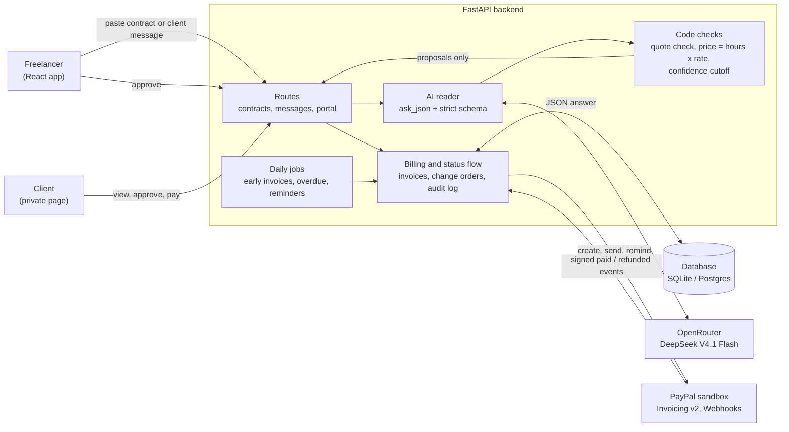

# Architecture

How MilestonePay fits together. The AI only proposes; code checks it, people approve, and only the billing code talks to PayPal.

## Reading the diagram

- **The AI never touches money.** Its answer goes to the code checks (every quote must appear in the source text, the price is hours times the hourly rate, low confidence means "possible") and comes back as a proposal.
- **Only approval moves money.** When the freelancer approves, the billing code creates the PayPal invoice and writes an audit entry.
- **PayPal tells us when it is paid.** Webhook events are signature-checked, and a paid invoice unlocks the client's files.
- **Daily jobs** invoice dated milestones early, mark late invoices overdue and send reminders.
